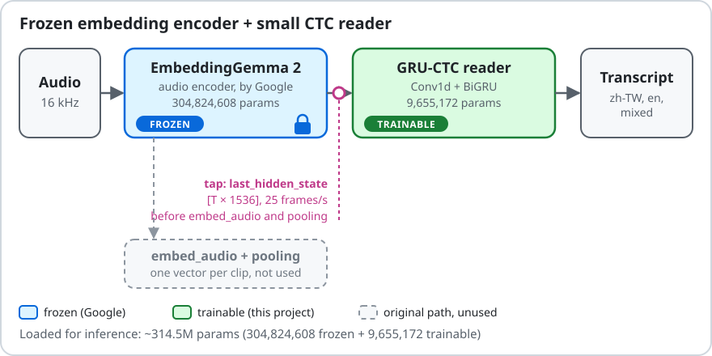
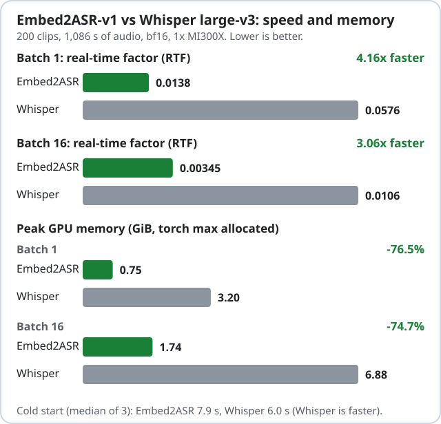

# Embed2ASR — Turning Audio Embeddings into Speech Recognition

**A frozen embedding encoder. A 9.66M trainable reader. Speech transcription without encoder fine-tuning.**

[English](README.md) · [繁體中文](README.zh-TW.md) · [Quick start](#quick-start) · [Benchmarks](docs/benchmarks.md) · [Model on Hugging Face](https://huggingface.co/tc3oliver/Embed2ASR-v1)


[](https://github.com/tc3oliver/embed2asr/actions/workflows/ci.yml)
[](https://github.com/tc3oliver/embed2asr/releases)
[](https://huggingface.co/tc3oliver/Embed2ASR-v1)

We repurposed an audio embedding model for speech recognition without fine-tuning its encoder. Embed2ASR takes the pre-pooling `last_hidden_state` of Google's EmbeddingGemma 2 audio encoder (1536-d frames, 25 per second; not the final pooled embedding vector) and decodes it with a 9,655,172-parameter GRU-CTC reader.

<p align="center"></p>

**Why it matters.** Can pretrained embedding representations be reused for tasks they weren't originally designed to perform? This project is one measured answer for audio embeddings and speech recognition (Mandarin, English and code-switching).

## Performance at a glance

<!-- PERF:HERO:BEGIN -->
**4.16× faster inference and 76.5% lower peak GPU memory than Whisper large-v3 at batch 1, measured on the same MI300X and the same clips.**
<!-- PERF:HERO:END -->

<p align="center"></p>

<!-- PERF:TABLE:BEGIN -->
|  | Embed2ASR-v1 | Whisper large-v3 | Difference |
| --- | --- | --- | --- |
| RTF, batch 1 (lower is better) | 0.0138 | 0.0576 | 4.16× faster |
| RTF, batch 16 (lower is better) | 0.00345 | 0.0106 | 3.06× faster |
| Peak GPU memory, batch 1 | 0.75 GiB | 3.20 GiB | -76.5% |
| Peak GPU memory, batch 16 | 1.74 GiB | 6.88 GiB | -74.7% |
| Cold start (median of 3) | 7.9 s | 6.0 s | Whisper faster |
<!-- PERF:TABLE:END -->

<!-- PERF:COND:BEGIN -->
Setup: one MI300X, idle before the run; ROCm 7.1, torch 2.10; bf16 for both systems. 200 clips (100 Mandarin + 100 English), 1,086 s of audio. Timing covers audio decode, features, model and text, not model loading; median of 3 passes after 1 warm-up. Whisper uses Hugging Face `generate`, greedy (`num_beams=1`). Embed2ASR at batch 16 uses `cross_file=True` (chunks of different files are batched together; about 4% of short clips can change by one unit; off by default). Memory is torch peak allocated, including the full audio encoder and the reader, not whole-process memory. Cold start is process start to first output. The figures apply to these two batch sizes on this hardware only. Transcripts can differ by +-1 unit across transformers versions and GPU models (identical within one environment); this benchmark ran on torch 2.10.0+rocm7.1.1, transformers 5.19.0, MI300X.
<!-- PERF:COND:END -->

This compares two different systems. The gap comes from several things we did not ablate (loaded model size, CTC versus autoregressive decoding, this test setup), so read it as a measurement of this pipeline, not as a property of embedding models. Accuracy is lower than Whisper large-v3 on most test sets: see [Accuracy](#accuracy-vs-whisper-large-v3).

Full protocol and extra numbers: [docs/benchmarks.md](docs/benchmarks.md).

## Architecture

The encoder is never updated. Only the 9,655,172-parameter reader is trained. About 314.5M parameters are loaded for inference.

## Accuracy vs Whisper large-v3

Whisper large-v3 is clearly more accurate on Common Voice zh-TW, on English (FLEURS, LibriSpeech) and on NTUML2021. Embed2ASR-v1 is more accurate on Parliament (both test sets) and on the mixed-language ASCEND sentences. On all ASCEND sentences taken together Whisper is slightly ahead. Speed does not change that: pick the model by the speech you need to transcribe.

Embed2ASR-v1's advantage on Parliament and ASCEND is measured on test sets from the same domain as its training distribution. NTUML2021 (ML2021_ASR_ST) is the only out-of-domain test set, and Whisper large-v3 is clearly more accurate on it, so these advantages should not be read as cross-domain generalization.

Test sets, evaluated once with the final checkpoint. Error rates, lower is better.

| Dataset | Metric | Embed2ASR greedy | + zh LM | Whisper large-v3 |
|---|---|---|---|---|
| Common Voice zh-TW 27.0 | CER | <!-- BENCH:cv_zh_tw_cer -->15.6%<!-- /BENCH --> | <!-- BENCH:cv_zh_tw_cer_lm -->14.7%<!-- /BENCH --> | <!-- BENCH:cv_zh_tw_cer_whisper -->9.6%<!-- /BENCH --> |
| Parliament test (set A) | CER | <!-- BENCH:parl_cer -->19.2%<!-- /BENCH --> | <!-- BENCH:parl_cer_lm -->19.0%<!-- /BENCH --> | <!-- BENCH:parl_cer_whisper -->22.7%<!-- /BENCH --> |
| ASCEND (mixed sentences only) | MER | <!-- BENCH:ascend_mix_mer -->23.9%<!-- /BENCH --> | <!-- BENCH:ascend_mix_mer_lm -->22.9%<!-- /BENCH --> | <!-- BENCH:ascend_mix_mer_whisper -->27.8%<!-- /BENCH --> |
| NTUML2021 (mixed) | MER | <!-- BENCH:ntuml_mer -->29.5%<!-- /BENCH --> | <!-- BENCH:ntuml_mer_lm -->28.9%<!-- /BENCH --> | <!-- BENCH:ntuml_mer_whisper -->16.0%<!-- /BENCH --> |
| FLEURS en_us | WER | <!-- BENCH:fleurs_en_wer -->24.5%<!-- /BENCH --> | – | <!-- BENCH:fleurs_en_wer_whisper -->4.5%<!-- /BENCH --> |
| LibriSpeech test-clean | WER | <!-- BENCH:libri_clean_wer -->9.0%<!-- /BENCH --> | – | <!-- BENCH:libri_clean_wer_whisper -->4.0%<!-- /BENCH --> |

CER = character error rate, WER = word error rate, MER = mixed error rate (Chinese characters + English words). The metrics are never averaged together. The LM is a Chinese character 5-gram, so English rows have no LM column. Parliament references are not verbatim, which puts a floor under its CER. All test sets and hardware: [docs/benchmarks.md](docs/benchmarks.md). Evaluation caveats: [docs/limitations.md](docs/limitations.md).

## Quick start

Inference needs two things: the EmbeddingGemma 2 encoder, which you download from Google under its own terms, and the Embed2ASR-v1 reader checkpoint.

<!-- QUICKSTART:BEGIN -->
### Install

Python 3.10+. Install a torch build for your accelerator first (CUDA, ROCm or CPU), then the package:

```bash
pip install torch --index-url https://download.pytorch.org/whl/rocm7.1   # or the CUDA / CPU wheel
pip install "git+https://github.com/tc3oliver/embed2asr.git"
```

The EmbeddingGemma 2 encoder and the Embed2ASR-v1 reader are downloaded from Hugging Face on first use. The first run fetches the `google/embeddinggemma-2` audio tower; run `hf auth login` first if the download asks for it.

### CLI

```bash
embed2asr transcribe audio.wav --model tc3oliver/Embed2ASR-v1
```

Options: `--device cpu|cuda`, `--batch-size N`, `--json` (text, duration, chunks, RTF per file). Several files can be passed in one call. Audio longer than 29.5 s is cut into consecutive chunks.

### Python API

```python
from embed2asr import Embed2ASR

asr = Embed2ASR.from_pretrained("tc3oliver/Embed2ASR-v1")  # uses CUDA/ROCm if available
result = asr.transcribe("audio.wav")
print(result.text)
```

`transcribe` also accepts a list of paths or a float array with `sr=`. It returns a `Transcript` with `text`, `duration` and per-chunk `chunks`.

### Local checkpoint

`--model` and `from_pretrained` also take a local release directory containing `config.json`, `model.safetensors`, `units.json` and `tokenizer_bpe.model`:

```bash
embed2asr transcribe audio.wav --model /path/to/embed2asr-v1
```
<!-- QUICKSTART:END -->

## Hear it

<!-- DEMO:BEGIN -->
Three code-switching utterances (Mandarin with English words, 3-6 s) from a development set. Embed2ASR output is greedy CTC; Whisper large-v3 output is unmodified, including its punctuation and casing. The first two are cases where Embed2ASR is closer to the reference, the last is a failure.

| reference | Embed2ASR | Whisper large-v3 |
|---|---|---|
| 有我想支持的隊伍的時候我就會very excited | 有我想支持的對伍的時候我就會very excited | 有我想支持的隊伍的時候,我就會非常興奮。 |
| 然後再來就是smart phone它的功能有的時候 | 然後再來就是smart phone他的功能有的時候 | 然後再來就是smartphone它的功能有的時候 |
| 你有抱過koala bear | 你有包過口阿拉伯 | 你有抱過Koala Bear嗎? |

Selection: picked by hand from 121 candidate utterances of that set. On those 121, Embed2ASR has a lower MER than Whisper large-v3 on 53 and a higher one on 59 (9 ties). The pool is not a benchmark; see the benchmark table for scores.
<!-- DEMO:END -->

## How it works

1. Encode. 16 kHz audio goes through the EmbeddingGemma 2 audio encoder (12-layer conformer plus output projection, 304,824,608 frozen parameters).
2. Tap before pooling. We take `last_hidden_state` of the audio tower: 1536-dimensional frames at 25 frames per second, before `embed_audio` and pooling.
3. Read. A 9,655,172-parameter reader (LayerNorm + Linear 1536→512, three residual Conv1d blocks, 2-layer BiGRU with 256 units per direction) predicts one of 4,996 CTC units per frame: blank, 4,596 CJK and other non-ASCII characters, 399 English BPE pieces. One output layer covers Chinese characters and English subwords.
4. Decode. Greedy CTC by default; optional Chinese character 5-gram LM with prefix beam search.

About 314.5M parameters are loaded for inference. Only the 9.66M reader is trained. Details: [docs/architecture.md](docs/architecture.md), [docs/method.md](docs/method.md).

## Why this matters beyond ASR

Embedding models pool their encoder states into one vector, which discards the time axis. The states before pooling still carry timing. Embed2ASR tests a narrow question: can a representation trained for one task (audio embeddings) be read by a small new head for a task it was never trained on (transcription)?

If it can, the same approach might apply to other time-aligned tasks, for example keyword spotting, language identification, audio event detection or forced alignment. Not validated here. This repository only tests speech recognition.

## Limitations

- Frozen encoder ceiling. On well-covered training sets, error on seen sentences stays close to dev error, which points to a representation limit.
- Homophones. CTC predicts each frame independently, so Mandarin errors are mostly same-sounding characters (在/再, 他/她).
- English. Function words and proper nouns are the main error sources; English trails Whisper large-v3.
- Code-switching evidence is narrow: the mixed-language dev set is small and recorded in Hong Kong.
- Offline only. No streaming mode.

Full list with evidence: [docs/limitations.md](docs/limitations.md).

## Reproduce

Training and evaluation: [docs/reproducibility.md](docs/reproducibility.md).

## Model card and weights

Embed2ASR-v1 artifacts (reader weights, tokenizer, unit list, optional 5-gram LM) are released under Apache-2.0. Model card: [docs/model_card_draft.md](docs/model_card_draft.md). Download links are added at release time. The EmbeddingGemma 2 encoder is not included.

## Citation

Cite this software with [CITATION.cff](CITATION.cff), and cite Google's EmbeddingGemma 2 as described in its model card.

```bibtex
@software{embed2asr,
  author  = {tc3oliver},
  title   = {Embed2ASR: Can an Embedding Model Become a Speech Recognition Model?},
  version = {0.1.0},
  url     = {https://github.com/tc3oliver/embed2asr},
  year    = {2026}
}
```

## Contributing

Bug reports, reproduction reports and benchmark reports are the most useful contributions. See [CONTRIBUTING.md](CONTRIBUTING.md).

## License

Code and model weights: Apache-2.0, see [LICENSE](LICENSE). The EmbeddingGemma 2 encoder is a separate download from Google under its own terms.
