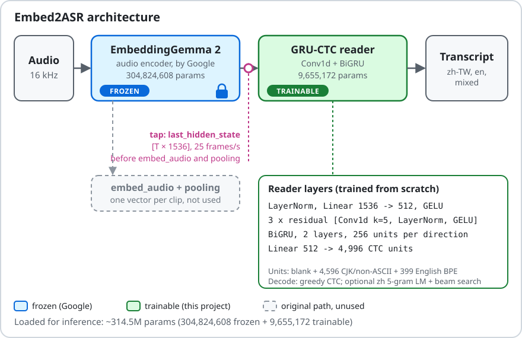

# Architecture



## Components

| Stage | What it is | Trainable | Parameters |
|---|---|---|---|
| Audio front end | 16 kHz mono waveform → log-mel features (EmbeddingGemma 2 processor) | no | – |
| Encoder | EmbeddingGemma 2 `audio_tower`: conv subsampling → 12 conformer layers (hidden 1024) → `output_proj` 1024→1536 | **no (frozen)** | 304.8M |
| Tap | `last_hidden_state` of the audio tower: `[T × 1536]`, 25 frames/s (one frame per 40 ms) | – | – |
| Reader | GRU-CTC reader, see below | **yes** | 9,655,172 |
| Decoder | Greedy CTC; optional Chinese character 5-gram LM with CTC prefix beam search | no | – |

Parameters loaded for inference: ~314.5M (encoder + reader). The reader is the only part trained by this project; "9.66M" is the trainable size, not the model size.

## Where we tap the encoder

EmbeddingGemma 2 is an embedding model. Its audio path is `audio_tower(...)` followed by `embed_audio` (RMSNorm and a projection into the text model's hidden space), after which the embedding pipeline pools to one vector per clip. That pooled vector is good for retrieval and similarity but has no time axis.

Embed2ASR reads `last_hidden_state`, which is the audio tower output **after** `output_proj` and **before** `embed_audio` and pooling. It keeps one 1536-d vector per 40 ms frame, which is what CTC needs.

A layer probe (see [method.md](method.md)) compared intermediate conformer layers with this tap; none was meaningfully better, so the tap stays at `last_hidden_state`.

## Reader

```
x [B, T, 1536]
→ LayerNorm(1536) → Linear(1536→512) → GELU
→ 3 × residual block: Conv1d(512, 512, k=5) → LayerNorm → GELU (+ dropout), added to the input
→ BiGRU layer 1 (512 → 2×256)
→ BiGRU layer 2 (512 → 2×256)
→ Linear(512 → 4,996)            # CTC logits per frame
```

Parameter breakdown (vocabulary 4,996):

| Part | Parameters |
|---|---|
| Input LayerNorm + Linear 1536→512 | 790,016 |
| 3 residual Conv1d blocks | 3,936,768 |
| 2-layer BiGRU, 256 per direction | 2,365,440 |
| Output Linear 512→4,996 | 2,562,948 |
| **Total** | **9,655,172** |

Notes:

- When GRU dropout is enabled, the 2-layer GRU is built as two single-layer GRUs with explicit dropout in between, because `nn.GRU(num_layers>1, dropout>0)` gives corrupted outputs in training mode on the ROCm builds we used. See [limitations.md](limitations.md#rocm-gru-dropout).
- The state-dict layout is compatible with the research checkpoints.

## Output units

One shared CTC output layer (4,996 units):

- index 0: CTC blank
- 4,596 single-character units: every CJK character and other non-ASCII character seen in training
- 399 English BPE pieces (SentencePiece, trained on the ASCII runs of the training text)

Text is split into runs: every non-ASCII character is its own unit, and every ASCII run (English words and spaces) is encoded with BPE. This lets a sentence switch between Chinese and English without a language tag. Characters not seen in training cannot be produced.

## Decoding

- **Greedy CTC** (default): argmax per frame, collapse repeats, drop blanks.
- **Optional LM**: Chinese character 5-gram (interpolated Kneser-Ney) with CTC prefix beam search (beam 16). It treats English BPE pieces as plain characters, so it is only meaningful for Chinese. Results with LM are always reported separately from greedy results.

## Compute shape

- Feature rate: 25 frames/s, so a 10 s clip gives 250 frames.
- Encoder input length: tested up to ~29.5 s per segment; longer audio must be segmented.
- Training runs on cached encoder features (the encoder is run once per utterance, offline). Inference runs the encoder live, so inference must load and run the full 304.8M encoder; the reader is small in parameters but its BiGRU is sequential in time, so it is not free at inference either.
