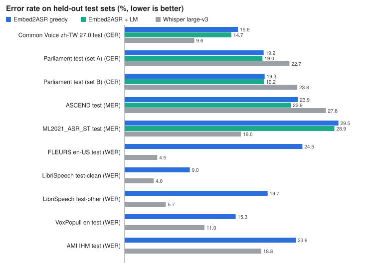

# Benchmarks

Embed2ASR-v1 against Whisper large-v3. Numbers on this page are produced from `benchmarks/` by scripts; do not edit the marked regions by hand.

## Speed and memory

Source: [`benchmarks/speed_v0.1.0.json`](../benchmarks/speed_v0.1.0.json). Figure: `assets/performance.svg`, generated by `scripts/make_perf_svg.py`. Tables: `scripts/fill_perf.py` (`--check` verifies that README, this page and the figure match the JSON).

<!-- PERF:TABLE:BEGIN -->
|  | Embed2ASR-v1 | Whisper large-v3 | Difference |
| --- | --- | --- | --- |
| RTF, batch 1 (lower is better) | 0.0138 | 0.0576 | 4.16× faster |
| RTF, batch 16 (lower is better) | 0.00345 | 0.0106 | 3.06× faster |
| Peak GPU memory, batch 1 | 0.75 GiB | 3.20 GiB | -76.5% |
| Peak GPU memory, batch 16 | 1.74 GiB | 6.88 GiB | -74.7% |
| Cold start (median of 3) | 7.9 s | 6.0 s | Whisper faster |
<!-- PERF:TABLE:END -->

Ratios and percentages are computed from the unrounded values in the JSON.

### Protocol

<!-- PERF:COND:BEGIN -->
Setup: one MI300X, idle before the run; ROCm 7.1, torch 2.10; bf16 for both systems. 200 clips (100 Mandarin + 100 English), 1,086 s of audio. Timing covers audio decode, features, model and text, not model loading; median of 3 passes after 1 warm-up. Whisper uses Hugging Face `generate`, greedy (`num_beams=1`). Embed2ASR at batch 16 uses `cross_file=True` (chunks of different files are batched together; about 4% of short clips can change by one unit; off by default). Memory is torch peak allocated, including the full audio encoder and the reader, not whole-process memory. Cold start is process start to first output. "Up to" refers to these two batch sizes on this hardware only. Transcripts can differ by +-1 unit across transformers versions and GPU models (identical within one environment); this benchmark ran on torch 2.10.0+rocm7.1.1, transformers 5.19.0, MI300X.
<!-- PERF:COND:END -->

- Clips: 200 (100 Common Voice zh-TW, 100 LibriSpeech test-clean), 1,085.6 s of audio in total. Batches never mix languages. Audio is decoded with ffmpeg inside the timed region; files are in the page cache.
- RTF = processing time / audio duration. Latency at batch 1 is per clip (600 samples = 200 clips x 3 passes); at batch 16 it is per batch (42 batches).
- Cold start is measured three times, each in a new process; the table shows the median. Whisper starts faster (6.0 s vs 7.9 s); imports and model loading are included. The Embed2ASR start includes loading the full EmbeddingGemma 2 checkpoint before only the audio tower is kept.
- GPU state: idle before the run (0% utilisation); it was not monitored during the run.
- The numbers hold for this hardware, these batch sizes and this audio mix. They are not a claim about other GPUs or other audio.

### More numbers

<!-- PERF:DETAIL:BEGIN -->
|  | Embed2ASR-v1 | Whisper large-v3 |
| --- | --- | --- |
| Latency p50 / p95, batch 1 (per clip) | 0.063 / 0.141 s | 0.239 / 0.753 s |
| Peak reserved memory, batch 1 | 0.83 GiB | 3.48 GiB |
| RTF of the 3 passes, batch 1 | 0.0141, 0.0137, 0.0138 | 0.057, 0.0584, 0.0576 |
| Latency p50 / p95, batch 16 (per batch of 16) | 0.251 / 0.399 s | 0.714 / 1.262 s |
| Peak reserved memory, batch 16 | 3.46 GiB | 8.09 GiB |
| RTF of the 3 passes, batch 16 | 0.00364, 0.00343, 0.00345 | 0.0106, 0.0103, 0.0109 |
<!-- PERF:DETAIL:END -->

## Accuracy

Test sets, evaluated once with the final checkpoint and frozen decoding settings. CER for Mandarin, WER for English, MER for code-switching. Reference and hypothesis go through the same normaliser; Whisper is scored the same way. Error rates, lower is better.

Embed2ASR-v1's advantage on Parliament and ASCEND is measured on test sets from the same domain as its training distribution. NTUML2021 (ML2021_ASR_ST) is the only out-of-domain test set, and Whisper large-v3 is clearly more accurate on it, so these advantages should not be read as cross-domain generalization.

<!-- ACC:BEGIN -->
| Test set | Subset | Metric | Utterances | Embed2ASR greedy | + zh LM | Whisper large-v3 |
|---|---|---|---|---|---|---|
| Common Voice zh-TW 27.0 test | zh | CER | 4,422 | 15.6% | 14.7% | 9.6% |
| Parliament test (set A) | zh | CER | 959 | 19.2% | 19.0% | 22.7% |
| Parliament test (set B) | zh | CER | 5,342 | 19.3% | 19.2% | 23.8% |
| ASCEND test | zh | CER | 628 | 22.7% | 21.4% | 17.8% |
| ASCEND test | zh-en mixed | MER | 358 | 23.9% | 22.9% | 27.8% |
| ASCEND test | en | WER | 229 | 44.6% | – | 26.3% |
| ML2021_ASR_ST test | zh | CER | 8,669 | 16.0% | 15.3% | 7.1% |
| ML2021_ASR_ST test | zh-en mixed | MER | 5,792 | 29.5% | 28.9% | 16.0% |
| ML2021_ASR_ST test | en | WER | 98 | 91.5% | – | 56.6% |
| FLEURS en-US test | en | WER | 621 | 24.5% | – | 4.5% |
| LibriSpeech test-clean | en | WER | 2,610 | 9.0% | – | 4.0% |
| LibriSpeech test-other | en | WER | 2,930 | 19.7% | – | 5.7% |
| VoxPopuli en test | en | WER | 1,829 | 15.3% | – | 11.0% |
| AMI IHM test | en | WER | 10,603 | 23.6% | – | 18.8% |
<!-- ACC:END -->

Subset is the language mix of the utterances (zh, zh-en mixed, en). Every test set was decoded exactly once with the frozen release; checkpoint, tokenizer, decoder parameters and test manifests are fixed by hash in [`benchmarks/v0.1.0.json`](../benchmarks/v0.1.0.json), and nothing was selected on these sets.

Scoring (identical for all systems): `embed2asr.normalize.norm` on reference and hypothesis (NFKC, lowercase, punctuation removed); corpus-level errors / reference units. CER counts characters, WER counts words, MER counts each CJK character and each Latin word as one unit. Utterances whose reference contains a digit are dropped. Whisper hypotheses additionally go through the number-to-words normaliser so spoken-form references are not penalised for emitting digits. Whisper runs batch 16, bf16, greedy, with a Traditional Chinese prompt and the language forced per batch (zh for zh and mixed, en for en). Embed2ASR hypotheses are used as emitted, without Simplified/Traditional conversion.

The language model (`--lm`, character 5-gram, order 5, alpha 0.25, beta 1.5, beam 16) only rescores CJK characters, so it applies to zh and zh-en mixed rows only; English rows show "–". Embed2ASR rows use the default per-file path.

## Environment

- GPU: AMD Instinct MI300X
- torch 2.10.0+rocm7.1.1, transformers 5.19.0, embed2asr 0.1.0
- Encoder: `google/embeddinggemma-2` at revision `914f7f89142e33e77833254d9c9b90c3cef7303b`, bf16; reader fp32
- Whisper: `openai/whisper-large-v3`, bf16, greedy (`num_beams=1`)

Hardware: <!-- BENCH:hw -->AMD Instinct MI300X<!-- /BENCH -->. Version: <!-- BENCH:version -->0.1.0<!-- /BENCH -->.

Filled by `scripts/fill_bench.py` from `benchmarks/v0.1.0.json`. Caveats: [limitations.md](limitations.md).
